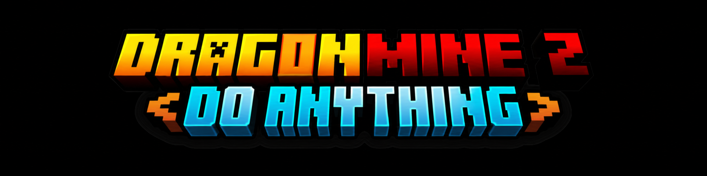
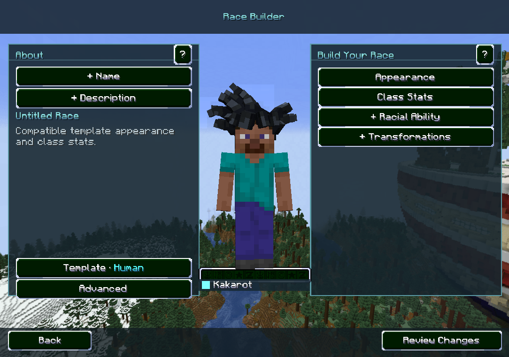
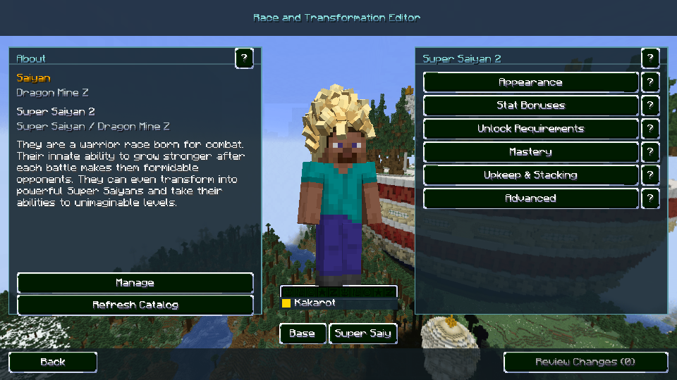
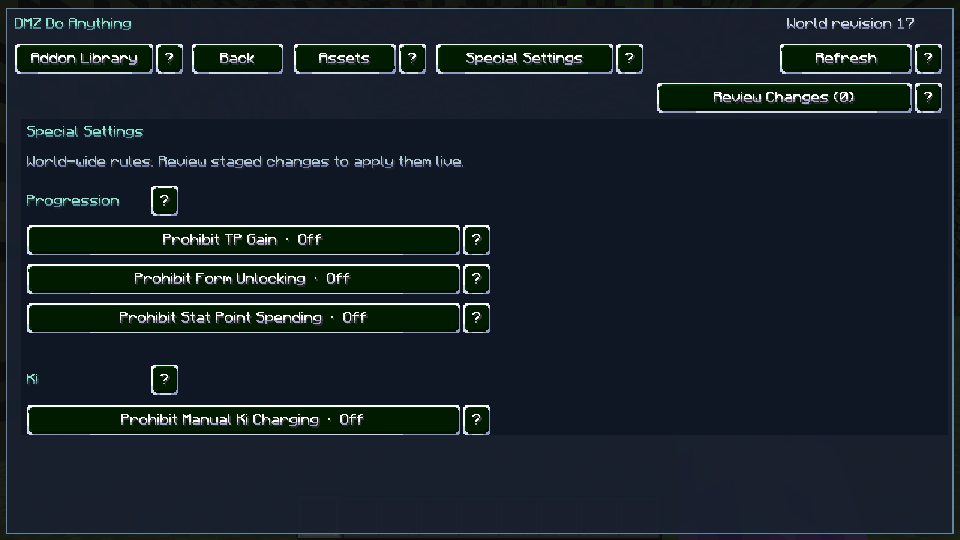

  

# DMZ Do Anything

DMZ Do Anything is an unofficial in-game race and transformation editor for DragonMine Z. Build races, balance forms, and apply gameplay rules live in singleplayer or on a dedicated server.

## Install and open

- Use Minecraft **1.20.1**, Forge **47.4.10** or **47.4.28**, and [DragonMine Z **2.2.1**](https://www.curseforge.com/minecraft/mc-mods/dragonminez) with GeckoLib, TerraBlender, and Curios API.
- Put the same DMZ Do Anything JAR in the server and client `mods` folders. Forge checks that the builds match when clients connect.
- Open the **Addon Library** with the administrator command `/dmzdoanything`. Search for races and forms by name, source, group, or stable ID.

## Race Builder

Create a race from a template or clone an installed race. Edit its description, starting appearance, class stats, racial ability, and draft transformations. Preview Base and each form on the rotating fighter.

## Race and Transformation Editor

Open a race from the library and choose **Base** or one of its forms. The Super Saiyan 2 example shows the appearance, stat, unlock, mastery, and upkeep menus. Available controls depend on the source and field. Use **?** for explanations and **Advanced** for exact IDs.

## Special Settings and world tools

| Restriction | Effect |
| --- | --- |
| Prohibit TP Gain | Blocks native gameplay Training Point gains. |
| Prohibit Form Unlocking | Blocks native purchases, upgrades, and grants for transformation skills. |
| Prohibit Stat Point Spending | Blocks native Stats screen spending with TP or Attribute Points. |
| Prohibit Manual Ki Charging | Blocks charge-key Ki recovery. Passive regeneration still works. |

All four restrictions start off. Use **Review Changes** to check staged edits before applying them live. **Revision History** can restore earlier settings and edits. **Delete Race** hides it from new character creation while existing characters keep their progress. **Restore Race** makes it selectable again.

Back up the world's `dbzdoanything` directory with the rest of the save. Third-party scripted progression can use its own reward or ability logic.

## Roadmap

Saga and quest editing is planned, including quest NPCs, spawns, required items, objectives, prerequisites, and rewards.

## Build and license

Run `./gradlew build` on macOS or Linux, or `gradlew.bat build` on Windows, with Java 17. The addon JAR is generated under `build/libs`.

This independent addon was developed with assistance from Codex and is licensed under [GPL-3.0-or-later](LICENSE). DragonMine Z and its in-game visuals belong to the [DragonMine Z team](https://www.curseforge.com/minecraft/mc-mods/dragonminez).
